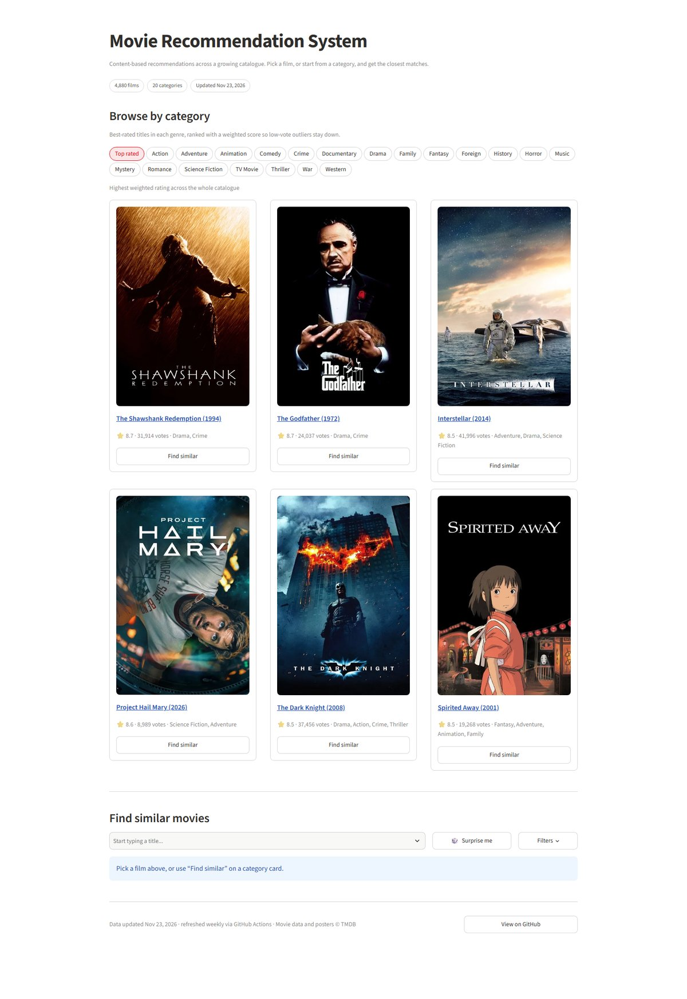

# Movie Recommendation System

A content-based movie recommender built on the [TMDB 5000 dataset](https://www.kaggle.com/datasets/tmdb/tmdb-movie-metadata).
Pick a film or a category and it returns the closest matches from ~4,900
titles, ranked by cosine similarity over TF-IDF features. The catalogue
refreshes itself every week from the TMDB API.

[](https://share.streamlit.io/deploy?repository=kushagrat052-sketch/movie-recommender&branch=main&mainModule=app.py)
[](https://codespaces.new/kushagrat052-sketch/movie-recommender)



## Try it

| | |
| --- | --- |
| **One-click cloud app** | [Deploy to Streamlit Community Cloud](https://share.streamlit.io/deploy?repository=kushagrat052-sketch/movie-recommender&branch=main&mainModule=app.py) — free, ~2 minutes, add `TMDB_API_KEY` under *Settings → Secrets* to enable posters. |
| **One-click dev environment** | [Open in GitHub Codespaces](https://codespaces.new/kushagrat052-sketch/movie-recommender) — installs dependencies and starts Streamlit on port 8501 automatically; the preview opens for you. |
| **One-click data refresh** | [Run the refresh workflow](https://github.com/kushagrat052-sketch/movie-recommender/actions/workflows/update-data.yml) — needs a `TMDB_API_KEY` repository secret. |
| **Local run** | `git clone` + `pip install -r requirements.txt` + `streamlit run app.py` (details below). |

## Features

- **Browse by category** — genre pills (Action, Comedy, Documentary, …) surface
  the best-rated titles in each category, ranked with the IMDb weighted rating
  so a 9.5 average from 30 votes never outranks an 8.1 from 8,000.
- **Find similar movies** — search the catalogue, or hit **Surprise me**.
  Filters for result count, minimum votes, minimum rating and genres live in a
  compact popover.
- **Posters and details** — poster art, rating, cast, director, genres and
  overview for the selected film, plus a match score for every recommendation.
- **Self-updating data** — a scheduled GitHub Action pulls new releases and
  refreshes vote counts every Monday, then commits the updated CSV. The UI
  shows when the data last changed.
- **Fast** — the TF-IDF model and posters are cached, so repeat queries are
  instant.


## How it works

1. `prepare_data.py` merges the movies and credits files and builds one `tags`
   string per movie from its overview, genres, keywords, top three cast members
   and director. Genres and the director are repeated so they carry a little
   more weight than the long overview.
2. `TfidfVectorizer` (unigrams + bigrams, sublinear TF) turns each `tags` blob
   into a sparse vector.
3. `cosine_similarity` scores the selected movie against every other movie.
   Vote/rating/genre filters are applied before the top N are returned.
4. `app.py` wires it up in Streamlit, caches the model and posters, and shows
   results as cards.

Example matches:

| You pick        | Top matches (similarity)                                          |
| --------------- | ----------------------------------------------------------------- |
| Inception       | Minority Report (0.21), Cypher (0.20), 2001: A Space Odyssey (0.17) |
| The Dark Knight | The Dark Knight Rises (0.41), Batman Begins (0.36), Batman Forever (0.26) |
| Toy Story       | Toy Story 2 (0.50), Toy Story 3 (0.37), Free Birds (0.17)          |

The absolute scores are low because the TF-IDF space is very sparse — the
ordering is what matters here.

## Keeping the data fresh

`update_data.py` talks to the TMDB API and:

- adds new films from `/movie/popular` and `/movie/now_playing`,
- refreshes `vote_average` / `vote_count` for films already in the catalogue,
- rebuilds the TF-IDF tags with the same logic used by `prepare_data.py`
  (shared in `features.py`),
- writes `data/last_updated.json`, which powers the "Updated …" label in the UI.

It is meant to be automated — [`.github/workflows/update-data.yml`](.github/workflows/update-data.yml)
runs it every Monday at 06:00 UTC and commits any changes. To enable it, add a
repository secret:

1. Repository → **Settings → Secrets and variables → Actions → New repository secret**
2. Name: `TMDB_API_KEY`, value: your TMDB v3 key.

You can also trigger it manually from the
[Actions tab](https://github.com/kushagrat052-sketch/movie-recommender/actions/workflows/update-data.yml)
or run it yourself:

```bash
python update_data.py           # reads TMDB_API_KEY from .env or the environment
UPDATE_PAGES=10 python update_data.py   # scan more popular pages (default 5)
```

Without a key the script exits cleanly and leaves the data untouched.

## Project structure

```
.
├── app.py                         # Streamlit UI
├── recommender.py                 # TF-IDF + cosine similarity engine
├── features.py                    # shared tag-building logic
├── prepare_data.py                # raw Kaggle CSVs -> movies_processed.csv
├── update_data.py                 # incremental refresh from the TMDB API
├── requirements.txt
├── requirements-dev.txt           # + pytest
├── data/
│   ├── raw/                       # Kaggle CSVs (git-ignored)
│   ├── movies_processed.csv       # committed, ready to use
│   └── last_updated.json          # timestamp + change summary for the UI
├── screenshots/
├── tests/test_recommender.py
├── .github/workflows/update-data.yml
├── .devcontainer/devcontainer.json  # Codespaces one-click environment
├── .streamlit/
│   ├── config.toml
│   └── secrets.toml.example
└── .env.example
```

## Run it locally

The processed CSV is already in the repo, so you can run the app right away:

```bash
git clone https://github.com/kushagrat052-sketch/movie-recommender.git
cd movie-recommender

python -m venv .venv
source .venv/bin/activate        # Windows: .venv\Scripts\activate
pip install -r requirements.txt

streamlit run app.py
```

### Posters (optional)

The app reads a TMDB API key from `.env` or `.streamlit/secrets.toml`. Without
one everything still works — you just get plain placeholders instead of posters.

```bash
cp .env.example .env
# then paste your key into .env
```

Get a free key from https://www.themoviedb.org/settings/api.

### Rebuilding the data from scratch

Only needed if you want to regenerate `movies_processed.csv` from the original
Kaggle files. Put both CSVs in `data/raw/`, then:

```bash
python prepare_data.py
```

## Tests

```bash
pip install -r requirements-dev.txt
pytest
```

The tests cover ranking order, self-exclusion, quality and genre filters,
category rankings, unknown titles and the shape of the loaded dataset.

## Deploy on Streamlit Community Cloud

1. Go to https://share.streamlit.io → **New app**, or use the
   [deploy link](https://share.streamlit.io/deploy?repository=kushagrat052-sketch/movie-recommender&branch=main&mainModule=app.py).
2. Pick `kushagrat052-sketch/movie-recommender`, branch `main`, file `app.py`.
3. Under **Settings → Secrets**, add:

   ```toml
   TMDB_API_KEY = "your_key_here"
   ```

## Known limitations

- It is purely content-based. Two movies are "similar" if their metadata
  overlaps; nothing here models whether people actually liked them, so a weak
  film with a matching plot can outrank a better one. The category view uses
  ratings as a quality signal, but the similarity ranking does not.
- New releases enter the catalogue through the weekly refresh only if they show
  up in TMDB's popular / now-playing lists, so the long tail is still limited to
  the original Kaggle snapshot.
- Overviews dominate the tags. Sentence embeddings or stemming would probably
  handle paraphrases better than TF-IDF.
- Movies with duplicate titles are dropped during preparation, and a few rows
  have no genres/keywords in the source data.

Data from the TMDB 5000 Movie Dataset on Kaggle. Movie metadata and posters
are © TMDB; this project is not affiliated with TMDB.

## License

MIT — see [LICENSE](LICENSE).
