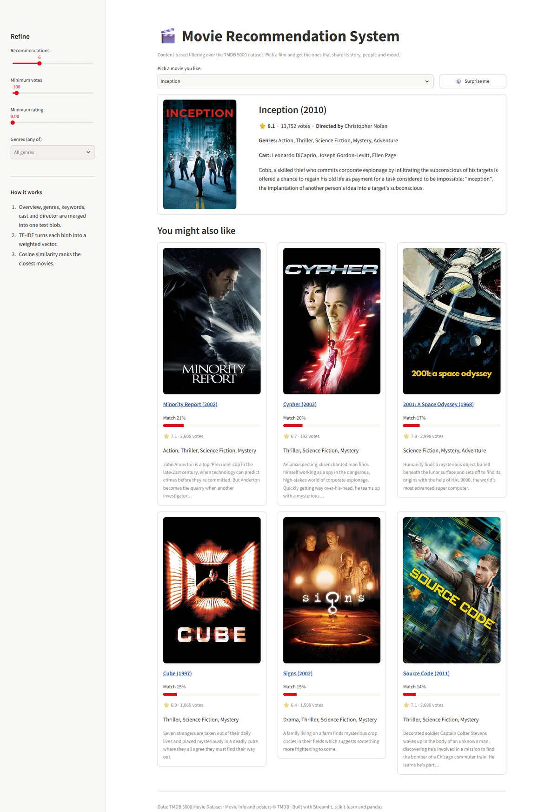

# Movie Recommendation System

A content-based movie recommender built on the [TMDB 5000 dataset](https://www.kaggle.com/datasets/tmdb/tmdb-movie-metadata).
Pick a film and it returns the closest matches from the ~4,800 titles in the
dataset, ranked by cosine similarity over TF-IDF features.



## How it works

1. `prepare_data.py` merges the movies and credits files and builds one `tags`
   string per movie from its overview, genres, keywords, top three cast members
   and director. Genres and the director are repeated so they carry a little
   more weight than the long overview.
2. `TfidfVectorizer` (unigrams + bigrams, sublinear TF) turns each `tags` blob
   into a sparse vector.
3. `cosine_similarity` scores the selected movie against every other movie.
   Vote/rating/genre filters are applied before the top N are returned.
4. `app.py` wires it up in Streamlit, caches the model and posters, and shows
   results as cards.

## Example output

| You pick       | Top matches (similarity)                                   |
| -------------- | ---------------------------------------------------------- |
| Inception      | Minority Report (0.21), Cypher (0.20), 2001: A Space Odyssey (0.17) |
| The Dark Knight| The Dark Knight Rises (0.41), Batman Begins (0.36), Batman Forever (0.26) |
| Toy Story      | Toy Story 2 (0.50), Toy Story 3 (0.37), Free Birds (0.17)   |

The absolute scores are low because the TF-IDF space is very sparse — the
ordering is what matters here.

## Project structure

```
.
├── app.py                      # Streamlit UI
├── recommender.py              # TF-IDF + cosine similarity engine
├── prepare_data.py             # raw CSVs -> movies_processed.csv
├── requirements.txt
├── requirements-dev.txt        # + pytest
├── data/
│   ├── raw/                    # Kaggle CSVs (git-ignored)
│   └── movies_processed.csv    # committed, ready to use
├── screenshots/app.jpg
├── tests/test_recommender.py
├── .streamlit/
│   ├── config.toml
│   └── secrets.toml.example
└── .env.example
```

## Run it locally

The processed CSV is already in the repo, so you can run the app right away:

```bash
git clone https://github.com/kushagrat052-sketch/movie-recommender.git
cd movie-recommender

python -m venv .venv
source .venv/bin/activate        # Windows: .venv\Scripts\activate
pip install -r requirements.txt

streamlit run app.py
```

### Posters (optional)

The app reads a TMDB API key from `.env` or `.streamlit/secrets.toml`. Without
one everything still works — you just get plain placeholders instead of posters.

```bash
cp .env.example .env
# then paste your key into .env
```

Get a free key from https://www.themoviedb.org/settings/api.

### Rebuilding the data

Only needed if you want to regenerate `movies_processed.csv`. Download the
Kaggle dataset, put both CSVs in `data/raw/`, then:

```bash
python prepare_data.py
```

## Tests

```bash
pip install -r requirements-dev.txt
pytest
```

The tests cover the ranking order, filters, unknown titles and the shape of
the loaded dataset.

## Deploy on Streamlit Community Cloud

1. Push the repo to GitHub (the processed CSV is small enough to commit).
2. Go to https://share.streamlit.io → **New app** → pick this repo, branch
   `main`, file `app.py`.
3. Under **Settings → Secrets**, add:

   ```toml
   TMDB_API_KEY = "your_key_here"
   ```

## Known limitations

- It is purely content-based. Two movies are "similar" if their metadata
  overlaps; nothing here models whether people actually liked them, so a weak
  film with a matching plot can outrank a better one. Blending in
  `vote_average` or real user ratings would fix that.
- The dataset stops around 2017, so recent releases are missing.
- Overviews dominate the tags. Sentence embeddings or stemming would probably
  handle paraphrases better than TF-IDF.
- Movies with duplicate titles are dropped during preparation, and a few rows
  have no genres/keywords in the source data.

Data from the TMDB 5000 Movie Dataset on Kaggle. Movie metadata and posters
are © TMDB; this project is not affiliated with TMDB.

## License

MIT — see [LICENSE](LICENSE).
